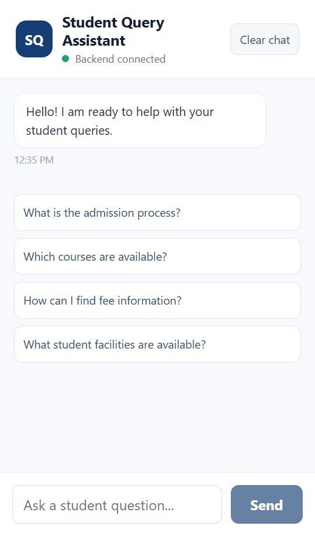
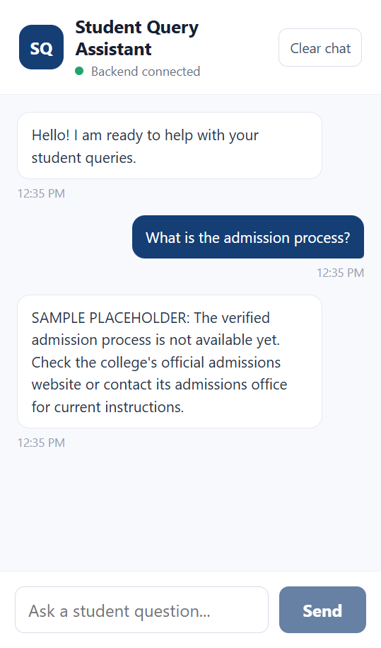
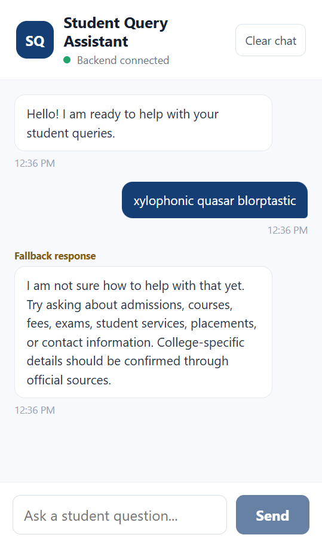
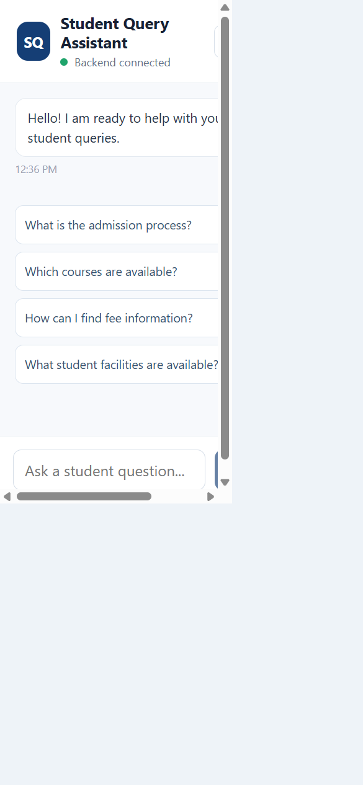

# AI Chatbot for Student Queries

A web chatbot that classifies student questions into predefined intents and
returns the matching response from a local JSON dataset. The application uses
React and Vite in the browser, FastAPI for the API, and a TF-IDF plus Logistic
Regression classifier for intent prediction.

> **Sample-data notice:** There is no official college dataset in this project.
> College-specific responses are marked `SAMPLE PLACEHOLDER:` and direct
> students to official sources. Do not treat these responses as college facts.

## Problem statement

Students often need to find information about admissions, courses, fees,
examinations, campus services, and other topics. This project demonstrates a
local chatbot interface that routes a question to a dataset-defined intent and
response. It is a prototype, not an official source of college information.

## Objectives

- Provide a responsive chat interface for student questions.
- Classify questions using a supervised intent model.
- Keep question examples and responses separate from application code.
- Use a confidence-based fallback when the query is not confidently handled.
- Validate the dataset and test both API and frontend behavior.
- Clearly identify unverified college-specific content.

## Features

- React chat UI with suggested questions, message history for the current page
  session, loading state, and a clear-chat action.
- FastAPI `GET /health` and `POST /chat` endpoints.
- Text normalization, character n-gram TF-IDF, and Logistic Regression.
- Dataset-backed response mapping; the first response in an intent's
  `responses` array is returned.
- Fallback for queries without TF-IDF features, low-confidence predictions,
  or missing response mappings.
- No database, generative AI, external LLM, or college-specific data source.

## Technology stack

| Area | Technology |
| --- | --- |
| Frontend | React, Vite, JavaScript, CSS |
| Backend | Python, FastAPI, Uvicorn |
| NLP and classifier | scikit-learn TF-IDF, Logistic Regression |
| Dataset | JSON |
| Model files | Joblib |
| Tests | pytest, FastAPI TestClient, Node.js built-in test runner |
| Lint/build | oxlint, Vite |

## Architecture

The browser sends questions to the FastAPI backend. At startup, the backend
loads the Joblib artifacts and dataset-backed response map. The classifier
normalizes a question, vectorizes it, and selects an intent. The response
service returns that intent's dataset response or the dataset fallback.

See [System architecture](docs/system-architecture.md) for the flow diagram and
[Chat API](docs/chat-api.md) for endpoint details.

## Project structure

```text
ChatBot/
|-- README.md
|-- docs/
|   |-- chat-api.md
|   |-- dataset-guide.md
|   |-- deployment.md
|   |-- demo-script.md
|   |-- demo-guide.md
|   |-- demo-storyboard.md
|   |-- evaluation/
|   |   |-- model_evaluation.json
|   |   |-- per_class_metrics.csv
|   |   `-- confusion_matrix.png
|   |-- nlp-pipeline.md        # Evaluation procedure and interpretation
|   |-- screenshots/
|   |   |-- main-interface.png
|   |   |-- successful-response.png
|   |   |-- fallback-response.png
|   |   |-- mobile-interface.png
|   |   `-- README.md          # Screenshot capture guide
|   |-- system-architecture.md
|   |-- testing-guide.md
|   `-- user-guide.md
|-- render.yaml                # Render backend service configuration
|-- vercel.json                # Vercel SPA routing configuration
|-- backend/
|   |-- app/
|   |   |-- api/                 # FastAPI route handlers
|   |   |-- core/                # Settings and paths
|   |   |-- nlp/                 # Preprocessing and classifier
|   |   `-- services/            # Chat orchestration and response mapping
|   |-- data/intents.json        # Sample intent patterns and responses
|   |-- models/                  # Joblib vectorizer and classifier
|   |-- tests/                   # pytest and API tests
|   |-- training/                # Dataset validation and model training
|   `-- requirements.txt
|-- frontend/
|   |-- src/
|   |   |-- components/          # Reusable chat UI components
|   |   `-- services/            # API client and Node tests
|   |-- .env                     # Vite API URL (local configuration)
|   |-- package.json
|   `-- package-lock.json
`-- documentation/               # Compatibility links to the docs/ guides
```

Generated folders such as `backend/.venv`, `frontend/node_modules`, and
`frontend/dist` are not source files.

## Requirements

- Windows PowerShell.
- Python 3.13 and the Python launcher (`py`). The current project environment
  was verified with Python 3.13.16.
- Node.js and npm. The current environment was verified with Node.js 26.13.1
  and npm 11.20.0.
- Internet access when installing Python or npm packages.

The dependency ranges are listed in `backend/requirements.txt` and
`frontend/package.json` / `frontend/package-lock.json`.

## Installation on Windows

Run commands from the project root (the directory containing `backend` and
`frontend`).

### Backend

If `backend\.venv` does not already exist:

```powershell
py -3.13 -m venv .\backend\.venv
```

Install backend dependencies:

```powershell
& .\backend\.venv\Scripts\python.exe -m pip install -r .\backend\requirements.txt
```

The current project includes model files in `backend\models`. If either model
file is missing, train the model from the backend directory:

```powershell
Set-Location .\backend
.\.venv\Scripts\python.exe -m training.train_model
```

Training validates the JSON dataset, evaluates a stratified holdout, and saves
artifacts fitted on the 66-example training partition. See
[NLP pipeline](docs/nlp-pipeline.md) before interpreting the evaluation.

### Frontend

```powershell
Set-Location .\frontend
npm ci
```

Vite reads the backend URL from `frontend\.env`. If that file is absent, create
it in the `frontend` directory:

```powershell
if (-not (Test-Path .env)) {
    Set-Content -Path .env -Value 'VITE_API_BASE_URL=http://127.0.0.1:8000' -Encoding ascii
}
```

The frontend API client uses this value as its base URL and appends `/chat` or
`/health`.

## Run the application

Start the backend and frontend in **separate PowerShell terminals**. In each
terminal, start from the project root.

**Terminal 1 - backend:**

```powershell
Set-Location .\backend
.\.venv\Scripts\python.exe -m uvicorn app.main:app --host 127.0.0.1 --port 8000 --reload
```

**Terminal 2 - frontend:**

```powershell
Set-Location .\frontend
npm run dev -- --host 127.0.0.1
```

The development server prints the frontend URL; by default it is
`http://127.0.0.1:5173`.

| Purpose | URL |
| --- | --- |
| Chat application | `http://127.0.0.1:5173` |
| API health endpoint | `http://127.0.0.1:8000/health` |
| Swagger UI | `http://127.0.0.1:8000/docs` |
| OpenAPI schema | `http://127.0.0.1:8000/openapi.json` |

`/health` is a basic process health endpoint. It does not confirm that model
artifacts loaded successfully; `/chat` returns HTTP `503` if the chatbot
service could not be initialized.

## Testing

From the project root, backend checks run inside the backend directory:

```powershell
Set-Location .\backend
.\.venv\Scripts\python.exe -m pytest
.\.venv\Scripts\python.exe -m training.validate_dataset
.\.venv\Scripts\python.exe -m compileall -q app training tests
```

Frontend checks run inside the frontend directory:

```powershell
Set-Location .\frontend
npm test
npm run lint
npm run build
```

See the [Testing guide](docs/testing-guide.md) for live API checks and expected
results.

## Current limitations

- `backend/data/intents.json` contains synthetic sample questions and
  placeholders, not verified college information.
- There are four example patterns per trainable intent. The fixed holdout has
  one example per intent and is too small to estimate real-world performance.
- Holdout accuracy is **0.4091**; macro precision is **0.2917**, macro recall
  is **0.4091**, and macro F1 is **0.3212**. These are not production
  performance claims.
- The confidence threshold is provisional and not calibrated. Some valid
  questions may receive fallback, and some incorrect predictions may pass the
  threshold.
- Conversation history is held in browser memory only. It is not stored across
  page reloads, and there is no database or user authentication.
- The classifier matches intent patterns; it does not generate answers or
  understand questions like a human.

## Screenshots

The images below were captured from the running application:

### Main interface



### Successful response



### Fallback response



### Mobile interface



The screenshot capture procedure is documented in
[docs/screenshots/README.md](docs/screenshots/README.md).

## Deployment preparation

The prepared deployment targets are **Render** for FastAPI and **Vercel** for
the React/Vite frontend:

- `render.yaml` contains the backend build/start configuration.
- `vercel.json` contains the Vite SPA fallback configuration.
- `backend/.env.example` and `frontend/.env.example` document environment
  variables without secrets.
- [Deployment guide](docs/deployment.md) lists the remaining account and URL
  steps.

The project has not been deployed unless a live health URL is verified. No live
URLs are claimed in this repository.

## Model evaluation outputs

The fixed holdout workflow writes:

- [Model evaluation JSON](docs/evaluation/model_evaluation.json)
- [Per-class metrics CSV](docs/evaluation/per_class_metrics.csv)
- [Confusion matrix](docs/evaluation/confusion_matrix.png)

The JSON and CSV files contain measured results only. Retrain and evaluate with:

```powershell
Set-Location .\backend
.\.venv\Scripts\python.exe -m training.train_model
```

## Future enhancements

- Replace placeholders with reviewed information from official college
  sources.
- Collect a substantially larger, diverse, verified set of student questions.
- Evaluate on a separate set of real queries and calibrate fallback behavior.
- Add an authorized content review/versioning process.
- Consider persistence, accessibility improvements, and deployment only after
  requirements and privacy safeguards are defined.

## More documentation

- [System architecture](docs/system-architecture.md)
- [Dataset guide](docs/dataset-guide.md)
- [NLP pipeline and evaluation](docs/nlp-pipeline.md)
- [Chat API](docs/chat-api.md)
- [Student user guide](docs/user-guide.md)
- [Testing guide](docs/testing-guide.md)
- [Project demonstration guide](docs/demo-guide.md)
