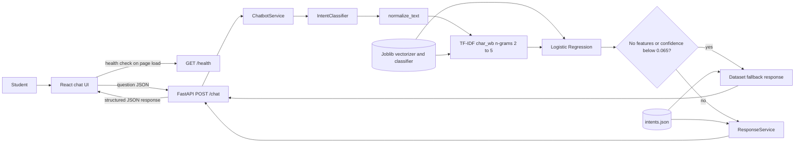

# System Architecture

## Overview

The project is a browser-based React application backed by one FastAPI
application. The frontend calls the backend over HTTP. The backend loads the
classifier artifacts and JSON response map once during FastAPI startup; it
does not load the model for every request.

`GET /health` is separate from the chat pipeline. It reports that the HTTP
application can answer a health request; it does not verify that the model
artifacts are available.

## Responsibilities

### Frontend

- `frontend/src/App.jsx` owns message state, loading state, backend status, and
  clear-chat behavior.
- `frontend/src/components/` contains the header, input, window, message, and
  suggested-question components.
- `frontend/src/services/chatApi.js` calls `GET /health` and `POST /chat`,
  validates the response shape, and converts network or HTTP errors into
  student-friendly messages.
- `VITE_API_BASE_URL` in `frontend/.env` configures the API host. The client
  removes trailing slashes before appending endpoint paths.
- Conversation messages live in React state and are not persisted.

### Backend

- `backend/app/main.py` creates the FastAPI application, configures CORS, adds
  routers, and initializes `ChatbotService` during the application lifespan.
- `backend/app/api/health.py` implements `GET /health`.
- `backend/app/api/chat.py` validates input and implements `POST /chat`.
- `backend/app/services/chatbot_service.py` coordinates prediction and
  response mapping.
- `backend/app/nlp/` contains the shared text normalizer and classifier.
- `backend/app/services/response_service.py` loads and validates the dataset
  response map. It returns the first response configured for an intent.

### Dataset and model files

- `backend/data/intents.json` stores intent labels, example patterns,
  trainability flags, response status, and response strings.
- `backend/models/tfidf_vectorizer.joblib` and
  `backend/models/logistic_regression.joblib` store the fitted pipeline parts.
- Fallback is represented in the dataset but excluded from model training.
- There is no database, external LLM, or external college-data service.

## Request-response flow

1. When the page opens, the frontend requests `GET /health` to show basic
   backend connectivity.
2. The student submits a question. The frontend sends
   `{"question": "<text>"}` to `POST /chat`.
3. FastAPI validates the question: it must contain searchable text, be no
   longer than 500 characters, and contain no extra request fields.
4. `ChatbotService` passes the question to the loaded `IntentClassifier`.
5. The vectorizer applies `normalize_text`, creates character n-gram TF-IDF
   features, and supplies those features to Logistic Regression.
6. If there are no features or the top probability is below `0.065`, the
   response service returns the dataset fallback. It also falls back if the
   predicted label has no configured response.
7. Otherwise, the response service returns the first response for the
   predicted intent.
8. FastAPI returns the intent, confidence, response, and fallback flag. The
   frontend displays the response and visually labels fallback answers.

See [Chat API](chat-api.md) for the exact schemas and HTTP behavior, and
[NLP pipeline](nlp-pipeline.md) for training and evaluation details.
